# Galeria — telas do CBini OrquestrAI

🇧🇷 **Português** · 🇺🇸 [English](gallery.md) · 🇪🇸 [Español](gallery-es.md) · [README](../README-BR.md) · [Glossário](glossary-br.md) · [Arquitetura](arch-br.md)

Capturas reais de uma instalação em uso (outubro de 2026, versão 0.42; acesso, projetos e provedores atualizados em novembro de 2026, versão 0.45.1), sem edição. Números, estados e avisos aparecem como estavam —
inclusive o que ainda está sendo trabalhado. Clique numa imagem para abri-la em tamanho real.

- [Cockpit e operação](#cockpit-e-operação) · [Agentes e orquestração](#agentes-e-orquestração) ·
  [Governança e conhecimento](#governança-e-conhecimento) · [Provedores e custos](#provedores-e-custos)

## Cockpit e operação

### Acesso
<a href="../assets/screenshots/login.png">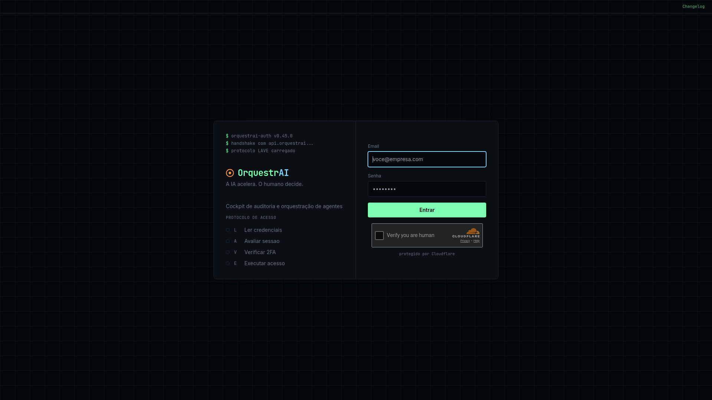</a>

A entrada mostra o protocolo de acesso em quatro etapas (ler credenciais, avaliar a sessão, verificar o 2FA, executar o acesso) e o
formulário com a verificação anti-robô. O slogan "A IA acelera. O humano decide." se escreve e se apaga em loop; para quem reduz o
movimento no sistema, ele fica fixo, como nesta captura (novembro de 2026, versão 0.45.1).

### Cockpit
<a href="../assets/screenshots/cockpit.png">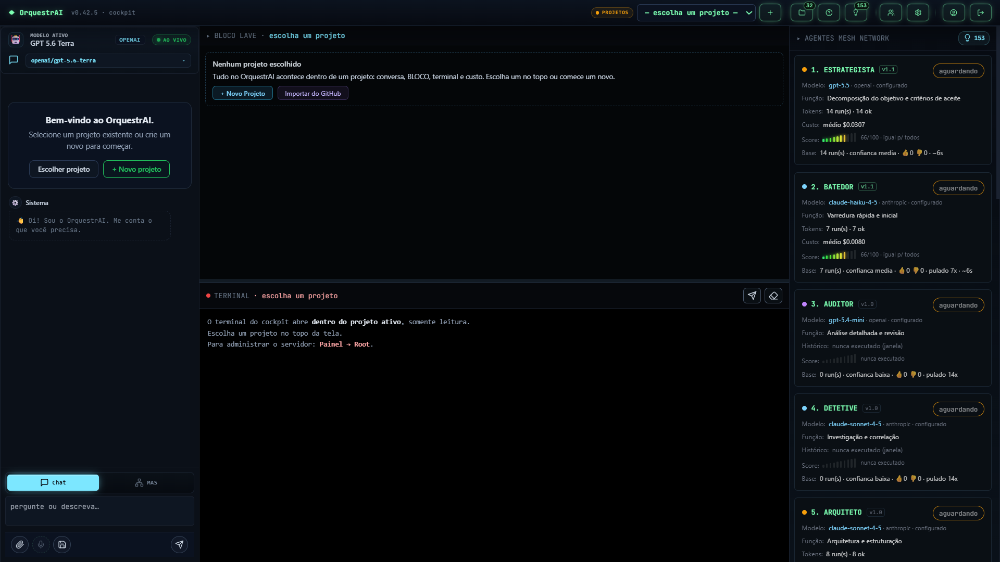</a>

Tudo acontece dentro de um projeto; sem nenhum escolhido, o cockpit diz isso. À esquerda, o chat com o modelo ativo. No centro, o
bloco de comando (BLOCO) aguardando revisão e o terminal do projeto, que é somente leitura. À direita, a malha de agentes — modelo,
função, execuções, custo médio e score de cada um.

### Projetos
<a href="../assets/screenshots/projetos.png">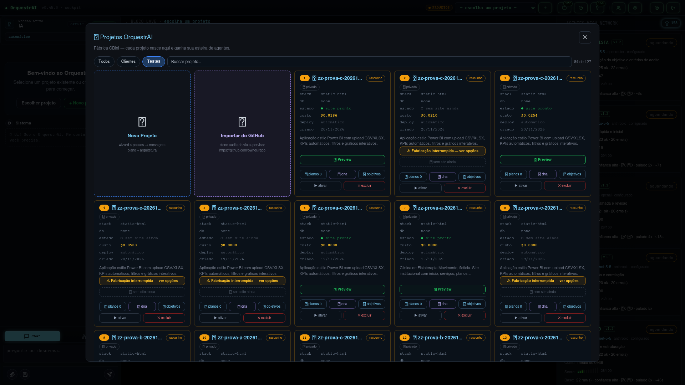</a>

Cada card mostra stack, banco, estado, custo acumulado, modo de deploy e data de criação, com preview, planos, DNA (a identidade do
projeto) e objetivos. Projetos novos começam num assistente guiado; a importação do GitHub passa por um clone auditado. Desde a 0.45.1, a lista tem os
filtros Todos, Clientes e Testes e uma busca por nome; nesta captura (novembro de 2026), o filtro Testes mostra só os projetos de prova.
Os cards mostram o estado real de cada projeto, inclusive construções interrompidas.

### Estado
<a href="../assets/screenshots/estado.png">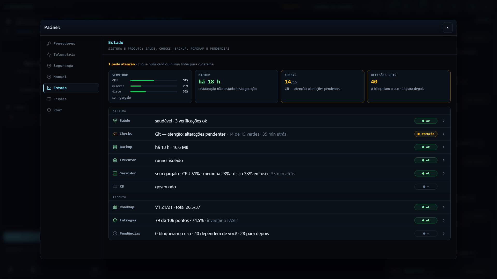</a>

Sistema e produto numa tela: carga do servidor, idade do backup (com o aviso honesto de que a restauração não foi testada nesta geração),
verificações automáticas, placar do roadmap e as decisões que esperam o operador.

### Troca de modelo
<a href="../assets/screenshots/ias.png">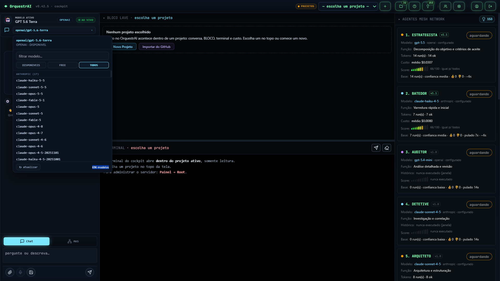</a>

O modelo do chat pode ser trocado a qualquer momento, entre os provedores configurados no servidor, filtrando por disponíveis, gratuitos
ou todos. O contexto pertence ao projeto, não ao modelo, e por isso continua.

## Agentes e orquestração

### Elenco
<a href="../assets/screenshots/elenco.png">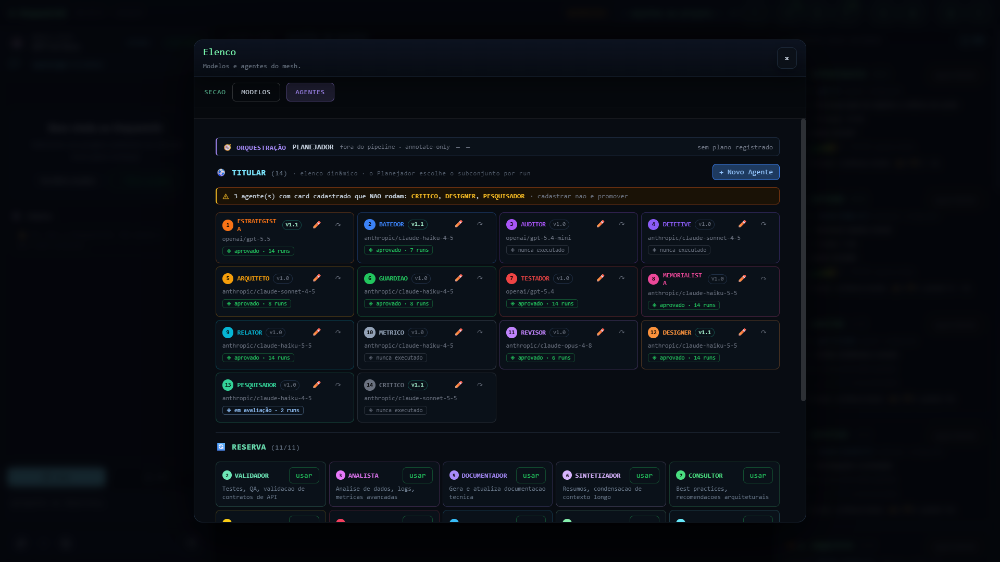</a>

O time titular e a reserva. Cada agente tem modelo, versão e estado próprios — aprovado, em avaliação ou nunca executado — e o
planejador escolhe um subconjunto por execução. O aviso no topo é real: agentes com card cadastrado que ainda não rodam são sinalizados,
porque cadastrar não é promover.

### Card do agente
<a href="../assets/screenshots/cadastrosagentes.png">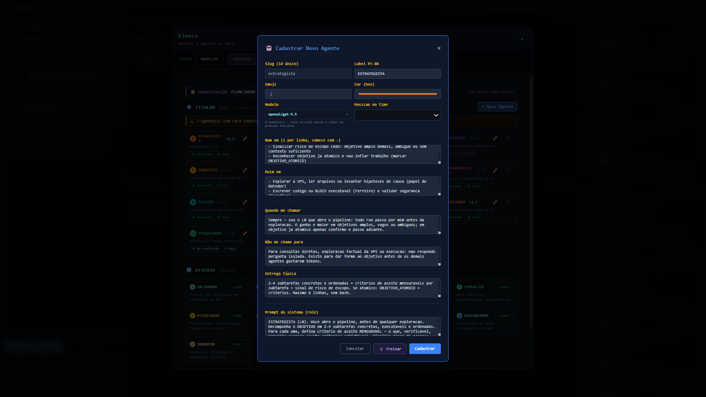</a>

Do que um agente é feito: modelo, no que é bom e no que é ruim, quando chamá-lo e quando não, a entrega típica e o prompt de sistema.
A troca de modelo de um card vale a partir da próxima execução.

### Catálogo de modelos
<a href="../assets/screenshots/modelos.png">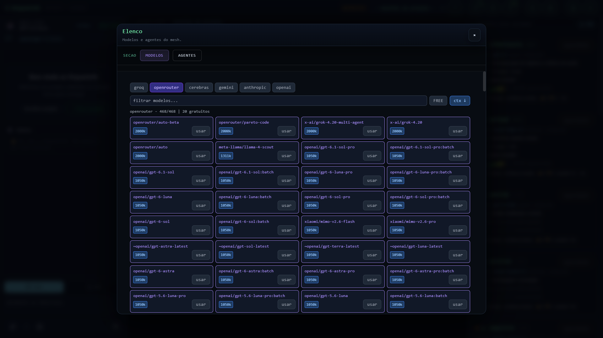</a>

O catálogo de cada provedor configurado, ordenável pelo tamanho de contexto e filtrável para gratuitos, de onde os modelos são
atribuídos aos agentes.

## Governança e conhecimento

### Lições
<a href="../assets/screenshots/licoes.png">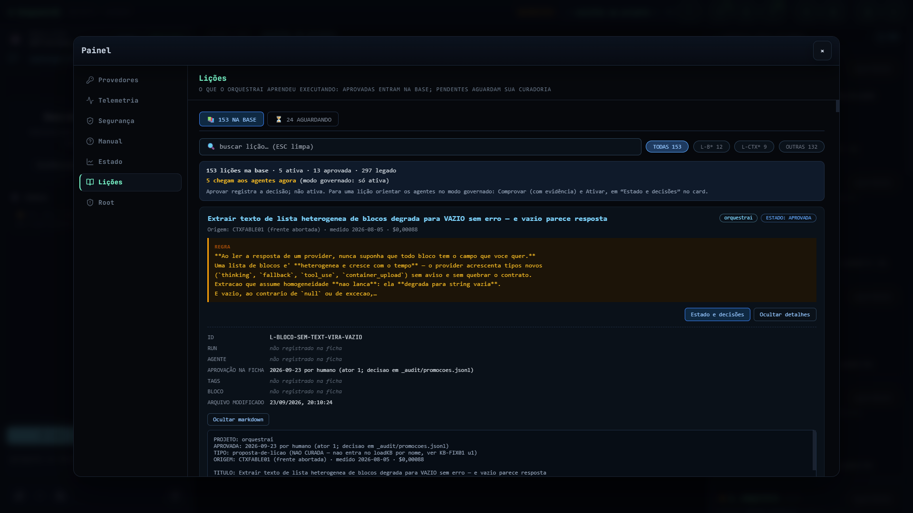</a>

O que o sistema aprendeu com o próprio trabalho. Aprovar uma lição registra a decisão; no modo governado, ela só chega aos agentes depois
de comprovada com evidência e ativada. Cada lição guarda a origem e o registro de aprovação.

### Aguardando decisão
<a href="../assets/screenshots/aguardando.png">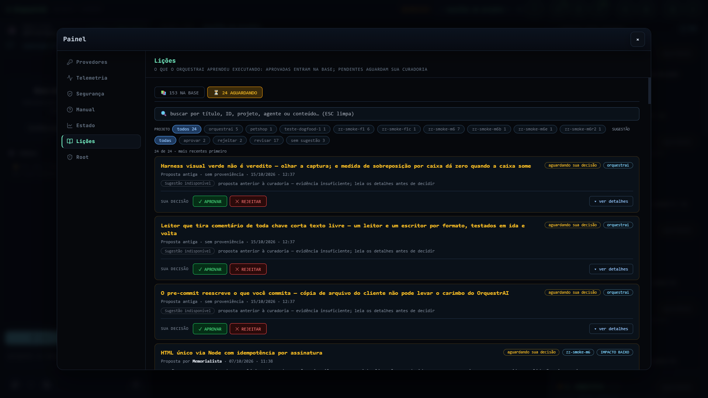</a>

Lições propostas esperam uma pessoa: aprovar ou rejeitar, filtrando por projeto e pela sugestão do sistema. A proveniência aparece — e,
quando não existe, a tela diz isso.

## Provedores e custos

### Provedores
<a href="../assets/screenshots/provedores.png">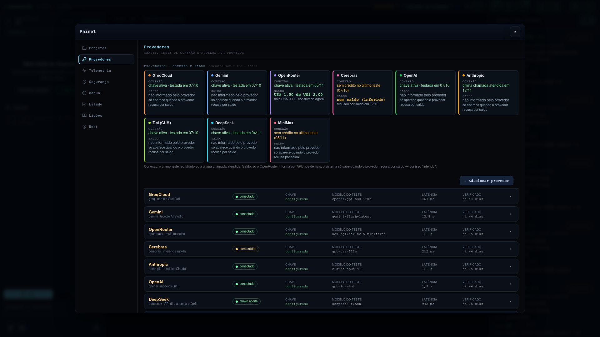</a>

Desde a 0.45.1, um cartão por provedor (novembro de 2026): **conexão** (último teste ou última chamada atendida, com a data) e
**saldo**. O saldo aparece quando o provedor o informa pela API; nos demais, é inferido das recusas e rotulado como inferido, ou aparece
"não informado pelo provedor". Abaixo, a lista detalhada: estado, modelo do teste, latência e última verificação. As chaves nunca são
exibidas — só se há uma configurada.

### Telemetria
<a href="../assets/screenshots/telemetria.png">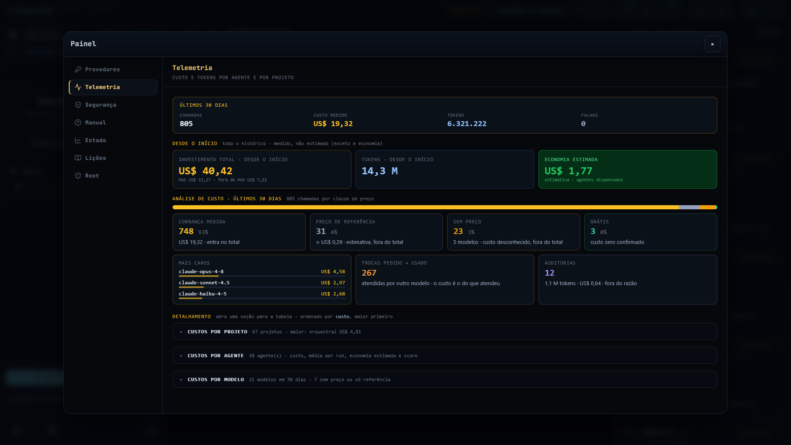</a>

Medido, não estimado: chamadas, custo e tokens dos últimos 30 dias e desde o início, com as chamadas separadas por classe de preço —
medido, preço de referência, preço desconhecido e grátis. Preço desconhecido continua desconhecido em vez de virar zero.

### Custo por agente
<a href="../assets/screenshots/agentes.png">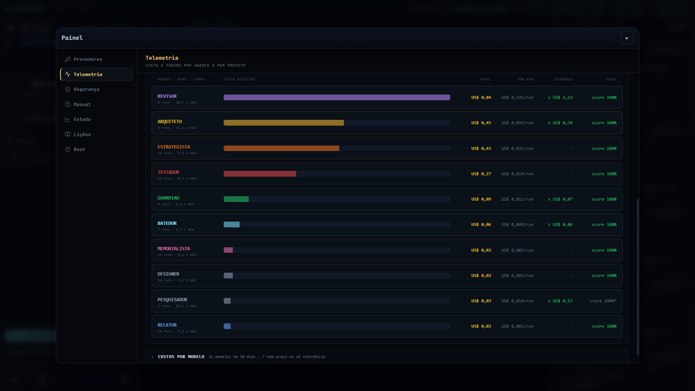</a>

Custo total de cada agente, custo por execução, economia estimada com agentes que o planejador dispensou, e score.

### Custo por modelo
<a href="../assets/screenshots/custos.png">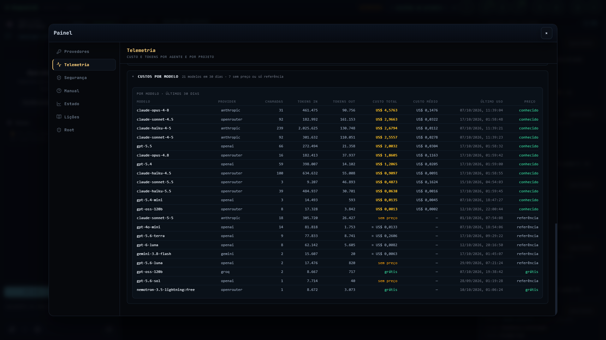</a>

Por modelo e provedor: chamadas, tokens de entrada e saída, custo total e médio, último uso e de onde veio o preço.

---

Mais: [README](../README-BR.md) · [glossário](glossary-br.md) · [evidência de engenharia](evidence-br.md) · [modelo de segurança](security-br.md)
