# Galería — pantallas de CBini OrquestrAI

🇪🇸 **Español** · 🇧🇷 [Português](gallery-br.md) · 🇺🇸 [English](gallery.md) · [README](../README-ES.md) · [Glosario](glossary-es.md) · [Arquitectura](arch-es.md)

Capturas reales de una instalación en uso (octubre de 2026, versión 0.42), sin edición. La interfaz está en portugués. Números, estados
y avisos se muestran como estaban — incluso lo que todavía está en desarrollo. Haga clic en una imagen para abrirla a tamaño real.

- [Cockpit y operación](#cockpit-y-operación) · [Agentes y orquestación](#agentes-y-orquestación) ·
  [Gobernanza y conocimiento](#gobernanza-y-conocimiento) · [Proveedores y costos](#proveedores-y-costos)

## Cockpit y operación

### Cockpit
<a href="../assets/screenshots/cockpit.png">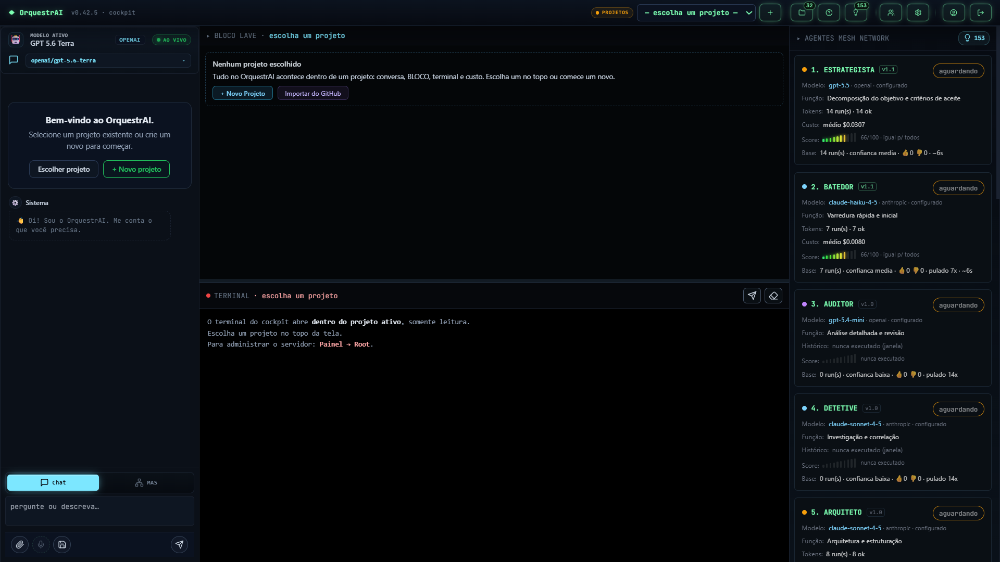</a>

Todo ocurre dentro de un proyecto; sin ninguno elegido, el cockpit lo dice. A la izquierda, el chat con el modelo activo. En el centro,
el bloque de comando (BLOCO) a la espera de revisión y la terminal del proyecto, que es de solo lectura. A la derecha, la malla de
agentes — modelo, función, ejecuciones, costo medio y puntuación de cada uno.

### Proyectos
<a href="../assets/screenshots/projetos.png">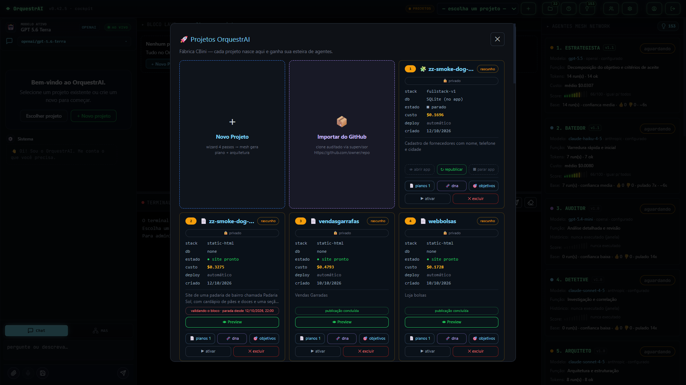</a>

Cada tarjeta muestra stack, base de datos, estado, costo acumulado, modo de despliegue y fecha de creación, con vista previa, planes,
ADN (la identidad del proyecto) y objetivos. Los proyectos nuevos empiezan en un asistente guiado; la importación desde GitHub pasa por un
clon auditado. Las tarjetas muestran el estado real de cada proyecto, incluido uno detenido mientras se validaba un bloque.

### Estado
<a href="../assets/screenshots/estado.png">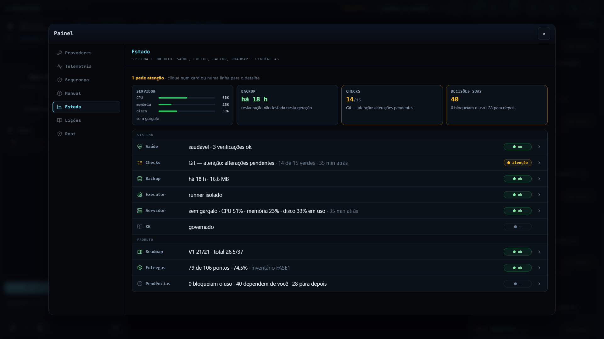</a>

Sistema y producto en una pantalla: carga del servidor, antigüedad del respaldo (con el aviso honesto de que la restauración no se probó
en esta generación), verificaciones automáticas, puntuación del roadmap y las decisiones que esperan al operador.

### Cambio de modelo
<a href="../assets/screenshots/ias.png">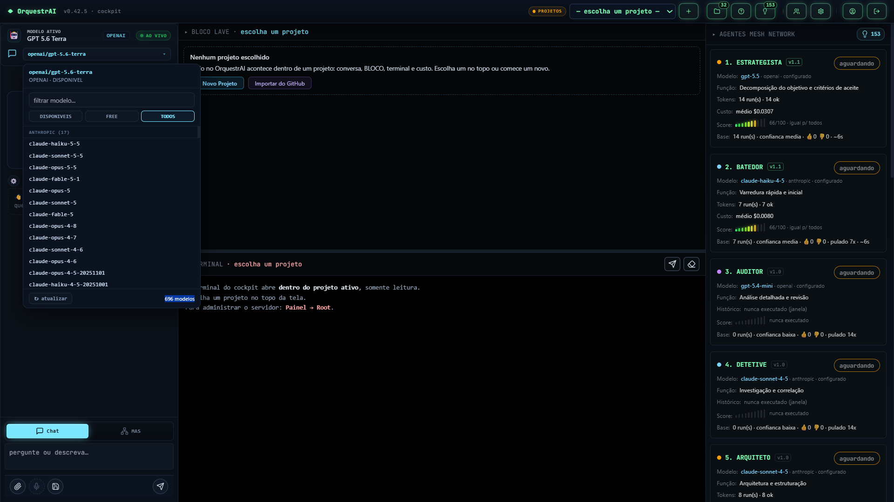</a>

El modelo del chat puede cambiarse en cualquier momento entre los proveedores configurados en el servidor, filtrando por disponibles,
gratuitos o todos. El contexto pertenece al proyecto, no al modelo, por eso continúa.

## Agentes y orquestación

### Elenco
<a href="../assets/screenshots/elenco.png">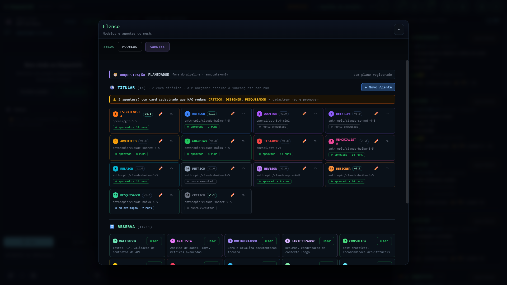</a>

El equipo titular y la reserva. Cada agente tiene su propio modelo, versión y estado — aprobado, en evaluación o nunca ejecutado — y el
planificador elige un subconjunto por ejecución. El aviso de arriba es real: los agentes con tarjeta registrada que todavía no se
ejecutan quedan señalados, porque registrar no es promover.

### Tarjeta del agente
<a href="../assets/screenshots/cadastrosagentes.png">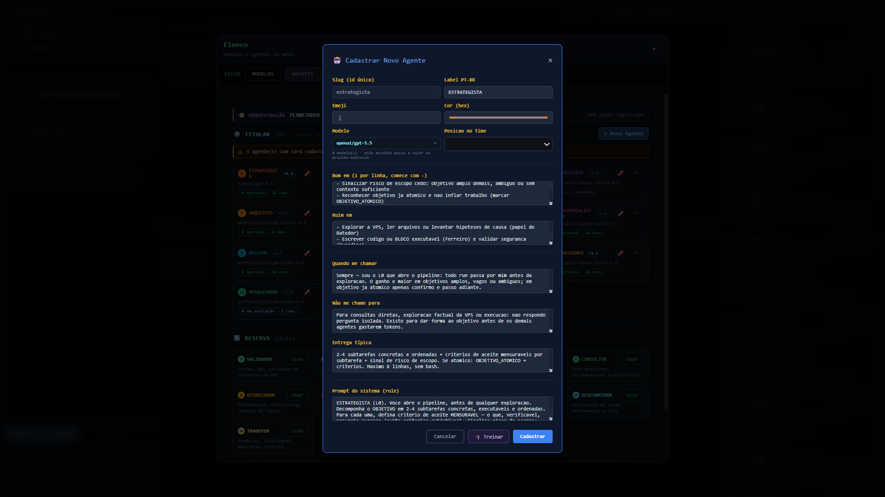</a>

De qué está hecho un agente: modelo, en qué es bueno y en qué es malo, cuándo llamarlo y cuándo no, su entrega típica y su prompt de
sistema. El cambio de modelo de una tarjeta vale desde la próxima ejecución.

### Catálogo de modelos
<a href="../assets/screenshots/modelos.png">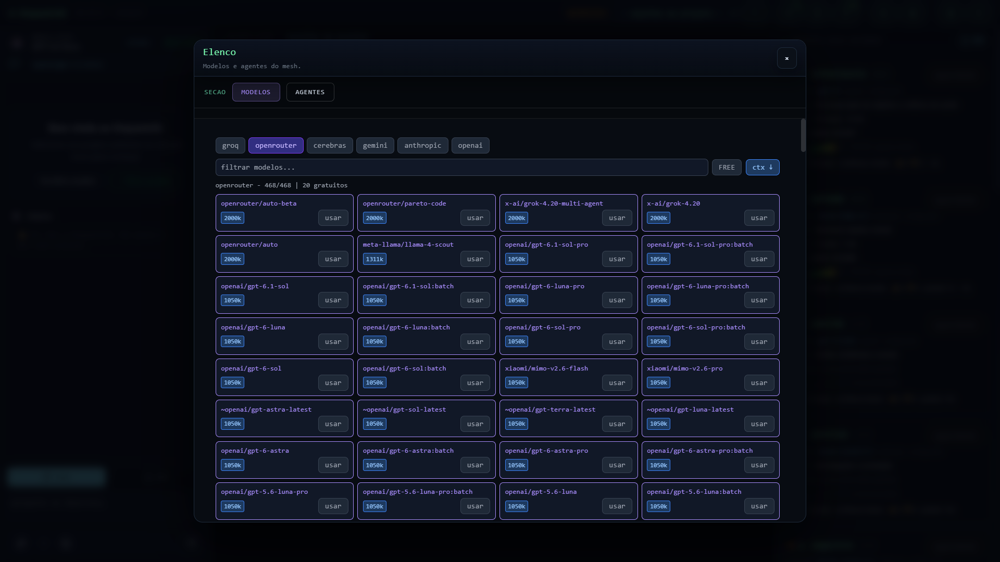</a>

El catálogo de cada proveedor configurado, ordenable por tamaño de contexto y filtrable a gratuitos, desde donde se asignan modelos a los
agentes.

## Gobernanza y conocimiento

### Lecciones
<a href="../assets/screenshots/licoes.png">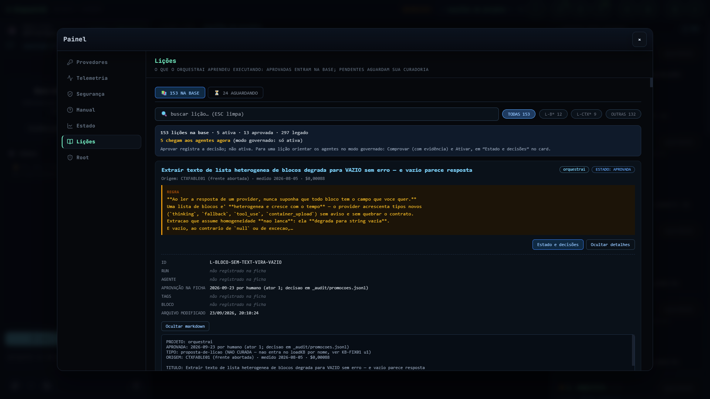</a>

Lo que el sistema aprendió de su propio trabajo. Aprobar una lección registra la decisión; en modo gobernado, solo llega a los agentes
después de comprobarse con evidencia y activarse. Cada lección conserva su origen y su registro de aprobación.

### En espera de decisión
<a href="../assets/screenshots/aguardando.png">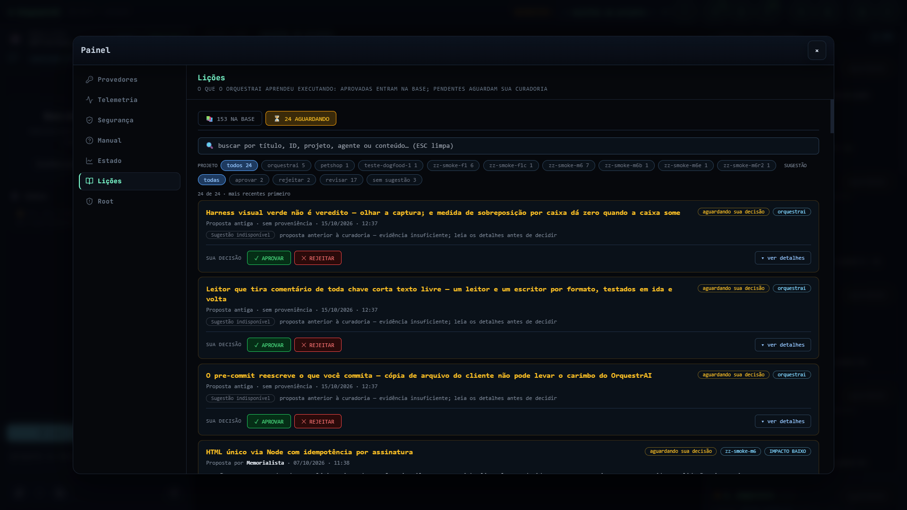</a>

Las lecciones propuestas esperan a una persona: aprobar o rechazar, filtrando por proyecto y por la sugerencia del sistema. La
procedencia se muestra — y, cuando no existe, la pantalla lo dice.

## Proveedores y costos

### Proveedores
<a href="../assets/screenshots/provedores.png">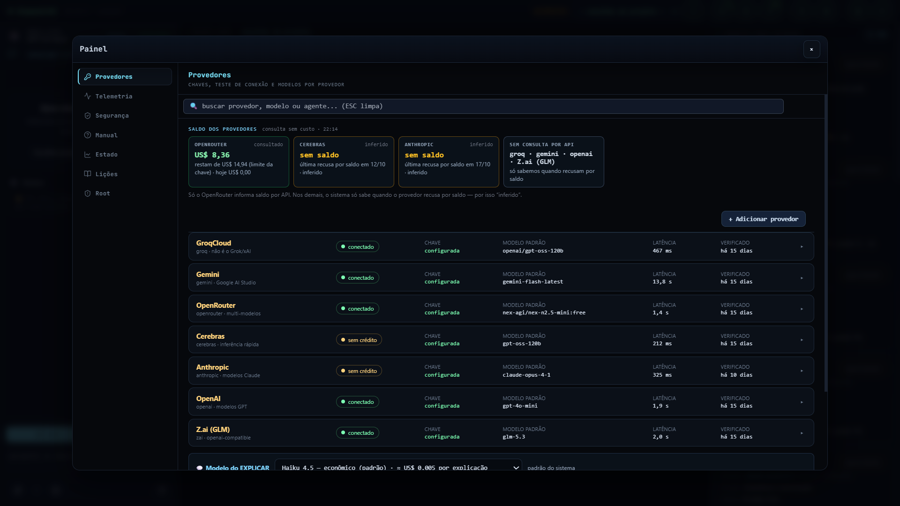</a>

Por proveedor: estado de conexión, modelo predeterminado, latencia y última verificación. El saldo aparece cuando el proveedor lo informa
por su API; en los demás se infiere de los rechazos y se marca como inferido. Las claves nunca se muestran — solo si hay una configurada.

### Telemetría
<a href="../assets/screenshots/telemetria.png">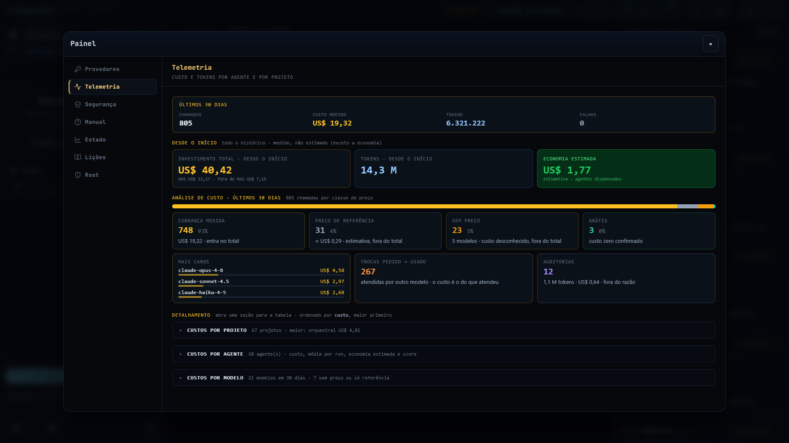</a>

Medido, no estimado: llamadas, costo y tokens de los últimos 30 días y desde el inicio, con las llamadas separadas por clase de precio —
medido, precio de referencia, precio desconocido y gratuito. Un precio desconocido sigue desconocido en lugar de volverse cero.

### Costo por agente
<a href="../assets/screenshots/agentes.png">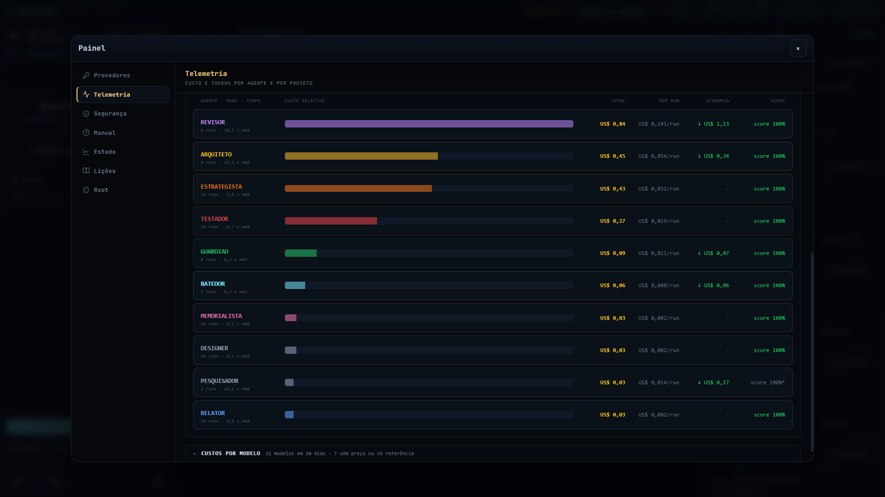</a>

Costo total de cada agente, costo por ejecución, ahorro estimado por agentes que el planificador descartó, y puntuación.

### Costo por modelo
<a href="../assets/screenshots/custos.png">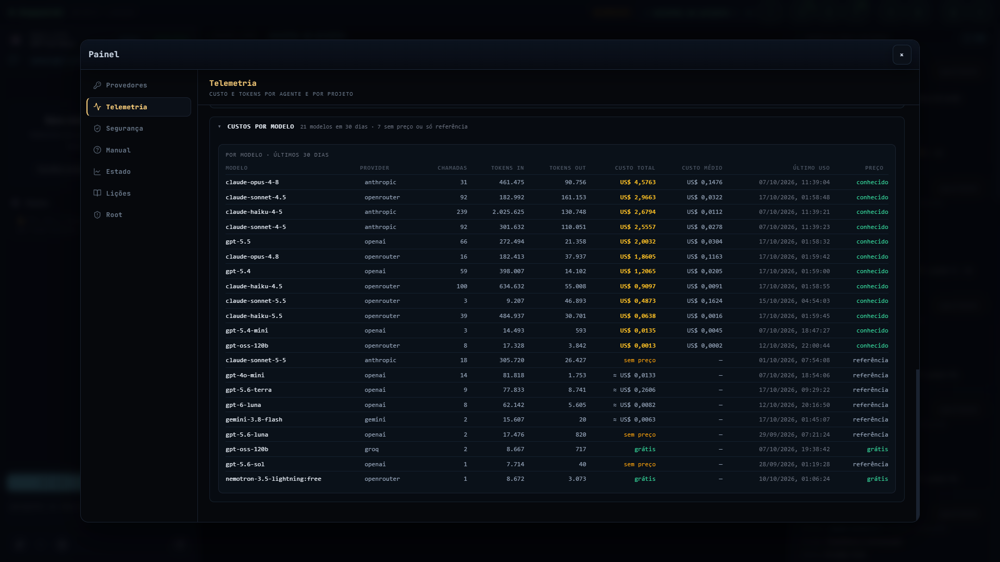</a>

Por modelo y proveedor: llamadas, tokens de entrada y salida, costo total y medio, último uso y de dónde vino el precio.

---

Más: [README](../README-ES.md) · [glosario](glossary-es.md) · [evidencia de ingeniería](evidence-es.md) · [modelo de seguridad](security-es.md)
