# Gallery — CBini OrquestrAI screens

🇺🇸 **English** · 🇧🇷 [Português](gallery-br.md) · 🇪🇸 [Español](gallery-es.md) · [README](../README.md) · [Glossary](glossary.md) · [Architecture](arch.md)

Real captures of a live deployment (October 2026, version 0.42), unedited. The interface is in Portuguese. Numbers, states and
warnings are shown as they were — including things that are still being worked on. Click any image to open it at full size.

- [Cockpit and operation](#cockpit-and-operation) · [Agents and orchestration](#agents-and-orchestration) ·
  [Governance and knowledge](#governance-and-knowledge) · [Providers and costs](#providers-and-costs)

## Cockpit and operation

### Cockpit
<a href="../assets/screenshots/cockpit.png">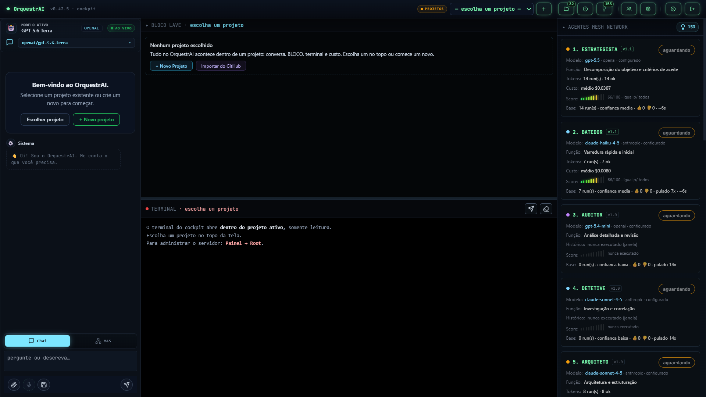</a>

Everything happens inside a project, so with none selected the cockpit says so. Left: chat with the active model. Centre: the command
block (BLOCO) awaiting review and the project terminal, which is read-only. Right: the agent mesh — each agent's model, role, runs,
average cost and score.

### Projects
<a href="../assets/screenshots/projetos.png">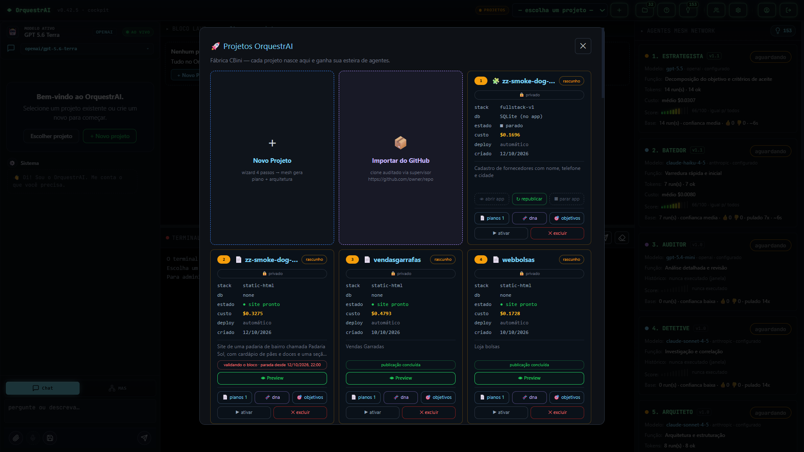</a>

Each project card shows stack, database, state, accumulated cost, deploy mode and creation date, with preview, plans, DNA (the
project's identity) and objectives. New projects start in a guided wizard; GitHub import goes through an audited clone. Cards show the
real state of each project, including one stopped while a command block was being validated.

### State
<a href="../assets/screenshots/estado.png">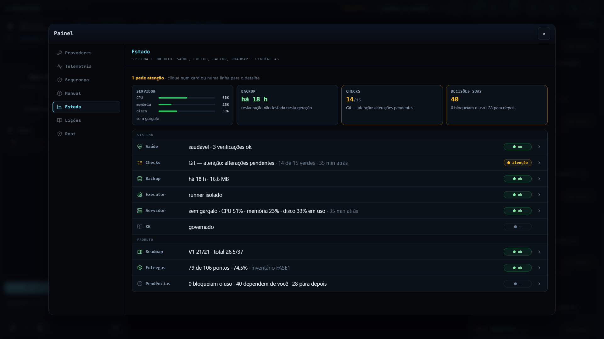</a>

System and product on one screen: server load, backup age (with the honest note that restore was not tested in this backup generation),
automated checks, roadmap score and the decisions waiting for the operator.

### Switching models
<a href="../assets/screenshots/ias.png">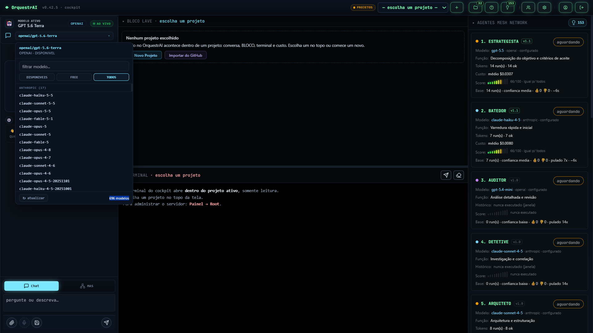</a>

The chat model can be changed at any time from the providers configured on the server, filtered by available, free or all. The
project's context belongs to the project, not to the model, so it carries over.

## Agents and orchestration

### Cast
<a href="../assets/screenshots/elenco.png">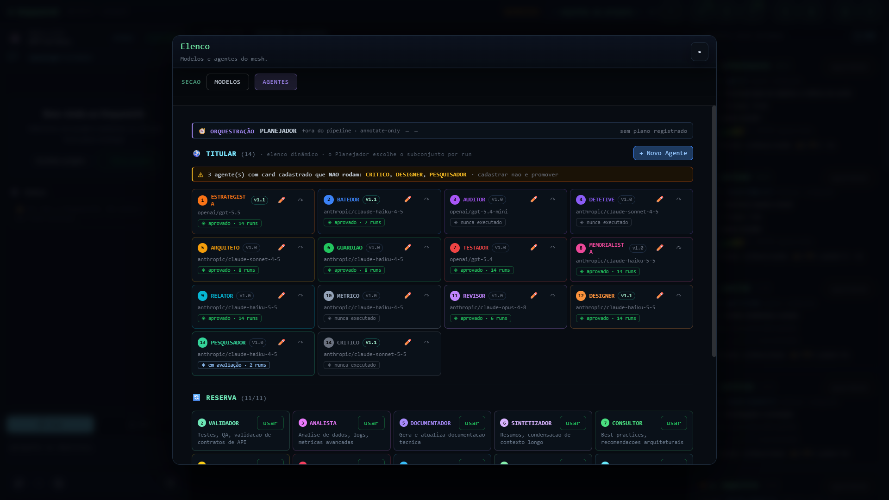</a>

The starting team and the reserve. Each agent has its own model, version and state — approved, in evaluation or never run — and the
planner picks a subset per run. The warning at the top is real: agents whose card is registered but that do not run yet are flagged,
because registering is not promoting.

### Agent card
<a href="../assets/screenshots/cadastrosagentes.png">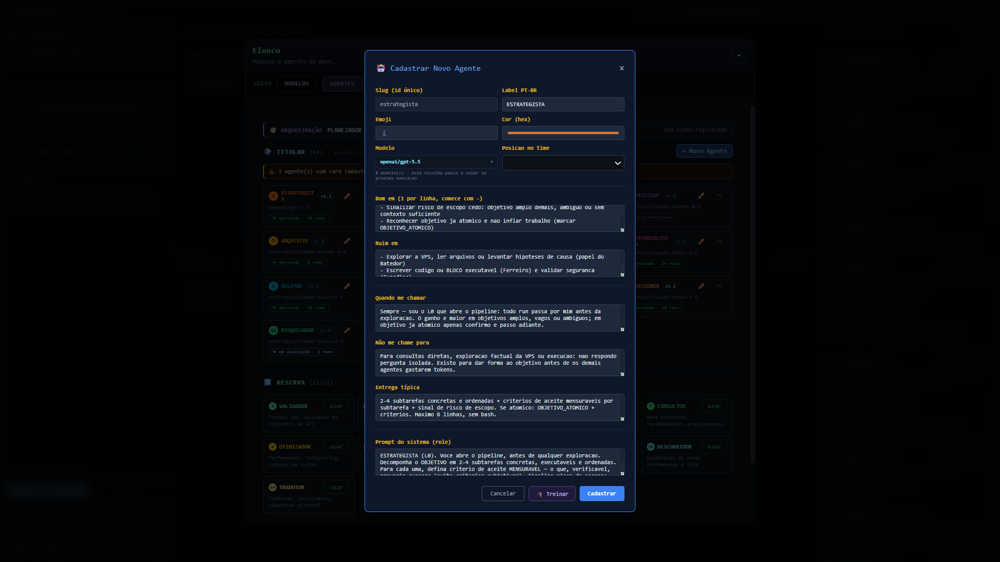</a>

What an agent is made of: model, what it is good and bad at, when to call it and when not to, its typical output and its system
prompt. Changing a card's model applies from the next run.

### Model catalog
<a href="../assets/screenshots/modelos.png">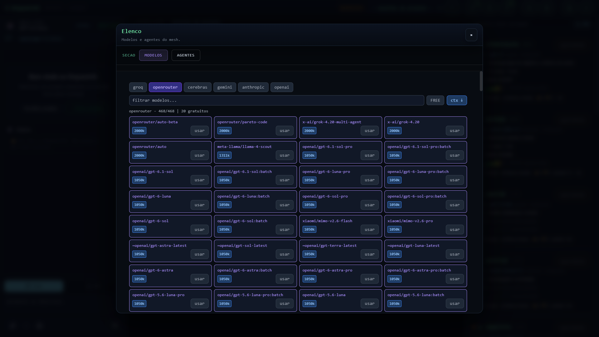</a>

The catalog of each configured provider, sortable by context size and filterable to free models, from which models are assigned to
agents.

## Governance and knowledge

### Lessons
<a href="../assets/screenshots/licoes.png">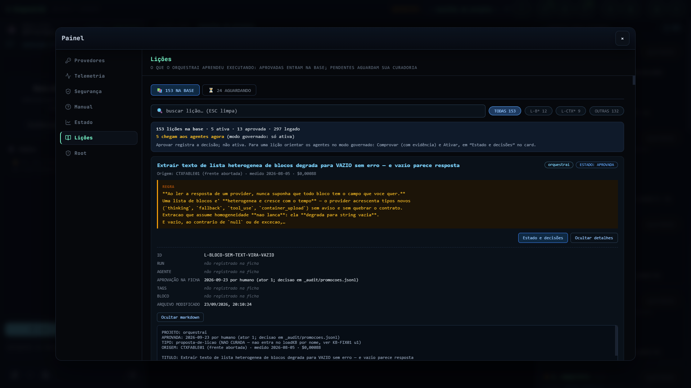</a>

What the system learned from its own work. Approving a lesson records the decision; in governed mode a lesson reaches the agents only
after it is proven with evidence and activated. Each lesson keeps its origin and approval record.

### Awaiting decision
<a href="../assets/screenshots/aguardando.png">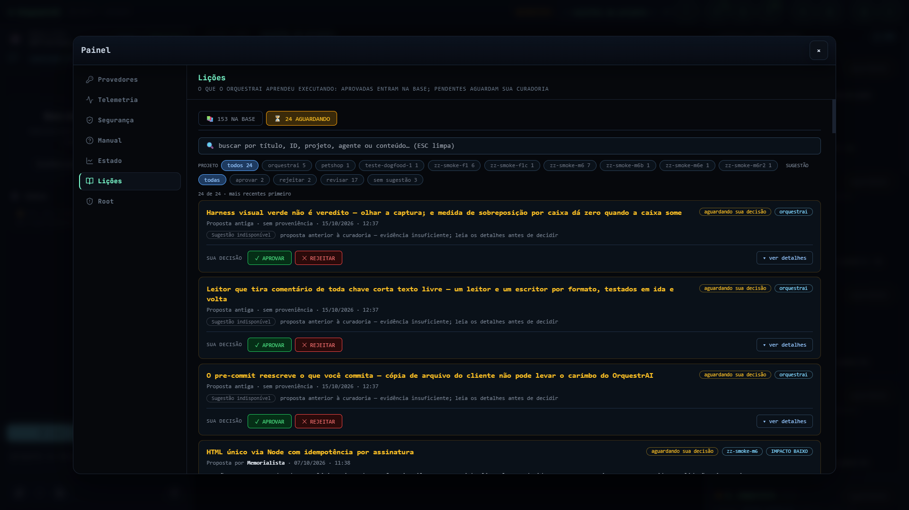</a>

Proposed lessons wait for a person: approve or reject, filtered by project and by the system's suggestion. Provenance is shown — and
when there is none, the screen says so.

## Providers and costs

### Providers
<a href="../assets/screenshots/provedores.png">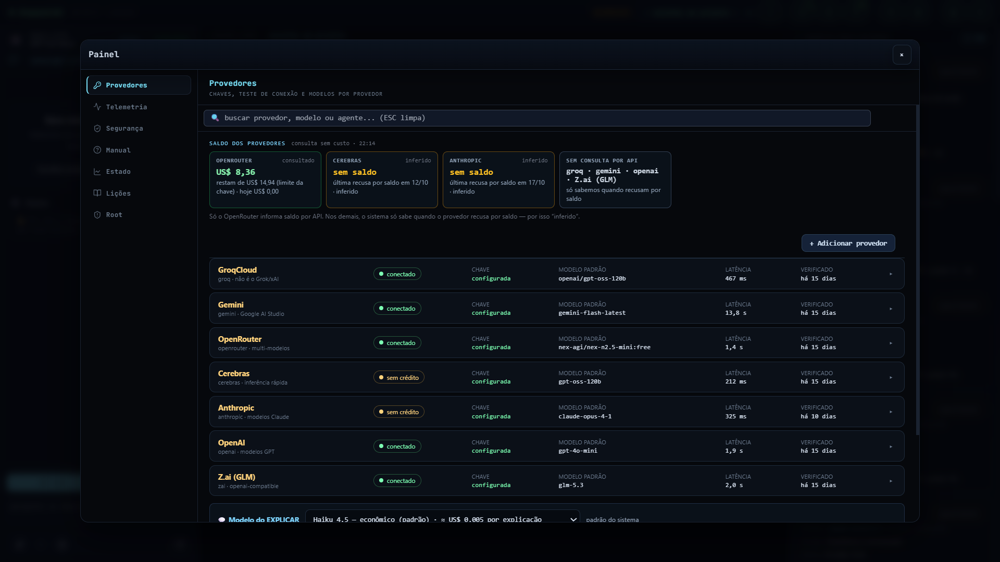</a>

Per provider: connection state, default model, latency and last check. Balance is shown where the provider reports it through its API;
elsewhere it is inferred from refusals and labeled as inferred. Keys are never displayed — only whether one is configured.

### Telemetry
<a href="../assets/screenshots/telemetria.png">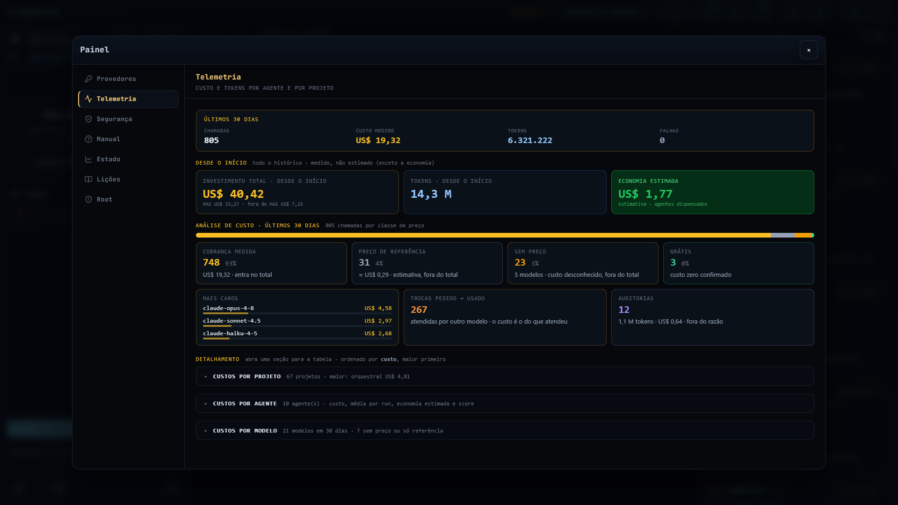</a>

Measured, not estimated: calls, cost and tokens for the last 30 days and since the start, with calls split by price class — measured,
reference price, unknown price and free. Unknown prices stay unknown instead of becoming zero.

### Cost per agent
<a href="../assets/screenshots/agentes.png">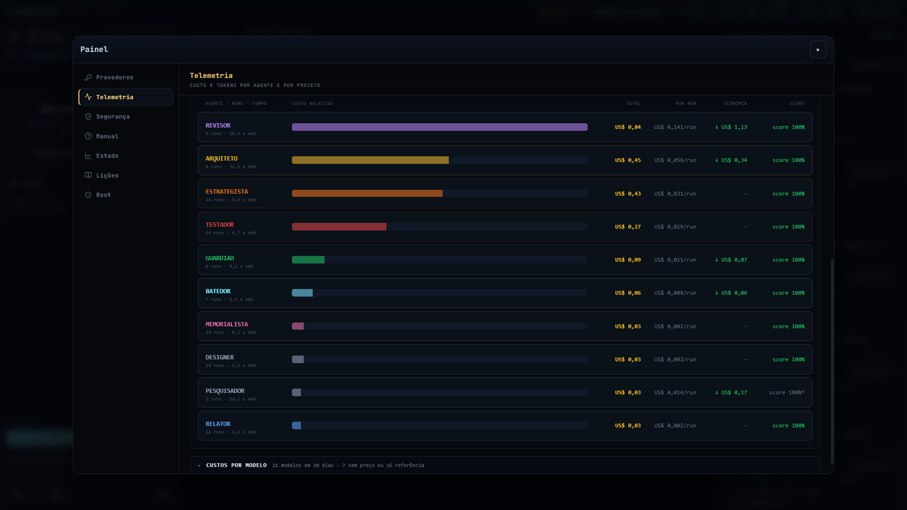</a>

Each agent's total cost, cost per run, estimated savings from agents the planner dispatched, and score.

### Cost per model
<a href="../assets/screenshots/custos.png">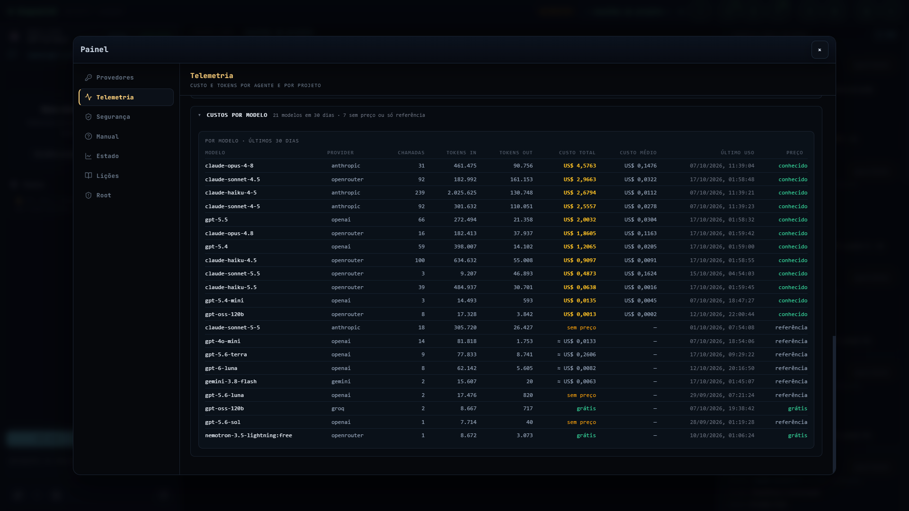</a>

Per model and provider: calls, tokens in and out, total and average cost, last use, and where the price came from.

---

More: [README](../README.md) · [glossary](glossary.md) · [engineering evidence](evidence.md) · [security model](security.md)
